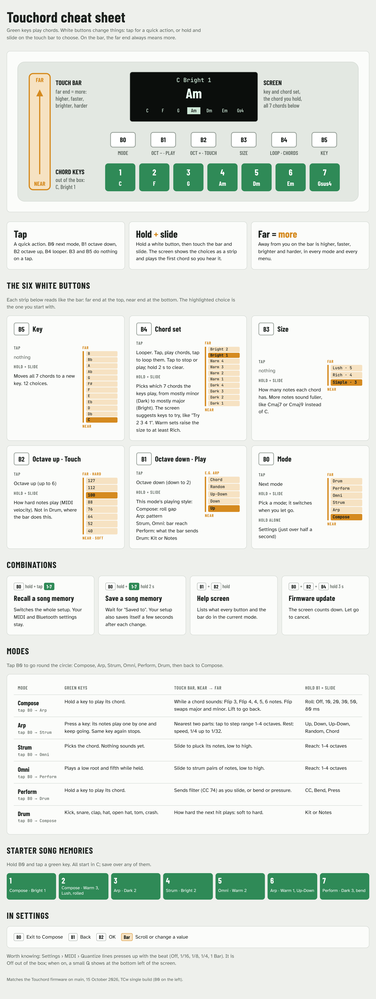

# PicoChord

**A pocket chord instrument for people who don’t play an instrument, or who just want something to pick up and play.**

Press a button, slide a finger along the touch bar, and a full chord comes out that fits the key you picked. There are no wrong notes to hit.

- 🎹 **Chords, not notes.** Seven green keys play the seven chords of your key, from simple triads to lush five-note voicings.
- 👆 **Hold and slide.** Hold a button and slide along the bar to change key, chord set or chord size, and hear a preview as you go.
- 🎶 **Many ways to play.** Strum it, arpeggiate it, roll it, or add a bass note underneath.
- 🔁 **Loop it.** Tap B4 to record a chord progression, tap again to loop it, then play over the top.
- 💾 **Ready out of the box.** Seven starter song memories come ready to play, each with a demo loop, and your settings save themselves.
- 🔌 **Plays anything.** Connects to any synth, DAW or phone over USB, Bluetooth or MIDI.
- 🛠️ **Open and hackable.** Built on the open-source [Touchord](https://github.com/dovker/Touchord) and runs on a Raspberry Pi Pico 2W.

## How to play

New to Touchord? Read the **[manual](docs/MANUAL.md)**, or keep the cheat sheet below to hand. Its HTML source is [docs/cheat-sheet.html](docs/cheat-sheet.html).

## Changes over upstream Touchord

TCw tracks [dovker/Touchord](https://github.com/dovker/Touchord) (currently v1.0.0). Everything below is new in TCw, most important first. [CHANGELOG.md](CHANGELOG.md) has the line-by-line list, and the [manual](docs/MANUAL.md) explains how to use each feature.

### Major features

- **Bluetooth LE MIDI.** Touchord shows up as a Bluetooth MIDI device called **Touchord** on macOS, iOS, Windows (MIDI apps with BLE support) and Android. It pairs with "Just Works" pairing and remembers the host. USB MIDI and TRS MIDI keep working alongside it.
  - Keys play whenever USB *or* Bluetooth is connected, so it can run from a battery or USB power bank.
  - **Settings > MIDI > Bluetooth** turns Bluetooth MIDI on or off and shows its status. The LED blinks slowly while USB or Bluetooth is connected.
  - "BT Connected" / "BT Disconnected" pops up on screen when a host connects or drops.
  - On iOS, connect from inside a MIDI app (GarageBand, midimittr); iOS Settings never lists BLE MIDI devices.
- **Raspberry Pi Pico 2 W support.** The build targets `pico2_w` by default. GPIO25 is the radio's chip select on the W boards, so the status LED is driven through the radio instead. A `Touchord-single.uf2` build suits the TCw wiring (see [Building](#building)).
- **Chord sets, key and size by hold-and-slide.** Hold a button and slide along the touch bar; a panel shows the choice and a short preview chord plays.
  - **Hold B5 + slide: key.** 12 zones, C to B.
  - **Hold B4 + slide: chord set.** Ten ready-made sets of 7 chords: Dark 1-4, Warm 1-4 and Bright 1-2. Out of the box it plays Bright 1 in C (C F G Am Dm Em Gsus4). The panel shows a loop to try on the keys.
  - **Hold B3 + slide: size.** Simple, Rich or Lush (3, 4 or 5 notes per chord).
  - The sets are also under **Settings > Chords**.
- **Arp mode** (B0 from Compose). Hold a key and its chord plays one note at a time.
  - Touch bar in 8 parts: six rates, fastest (1/32) at the far end down to 1/4, then the two parts nearest you together: each tap steps the range through 1-4 octaves.
  - Latch is on by default: the arp keeps going after you let go, another key changes chord, and the same key again stops it. Turn it off under **Settings > Modes > Arp**.
  - Hold B1 and slide to pick the pattern: Up, Down, Up-Down, Random, Chord.
  - Pattern, rate, range, gate, tempo and latch are also under **Settings > Modes > Arp**.
- **It remembers, and has song memories.** The setup you are playing is saved by itself a few seconds after you stop changing it (only while nothing is playing), in its own flash sector, and comes back at power-on, mode included. Hold B0 and tap a green key to switch to memory 1-7; keep the key held for 2 seconds to save the current setup there instead. Memories are preset slots 1-7, and MIDI and Bluetooth settings stay as they are when you switch. Out of the box each one holds a starter setup: 1 Compose · Bright 1, 2 Compose · Warm 3 rolled 9ths, 3 Arp · Dark 2, 4 Strum · Bright 2, 5 Omni · Warm 2, 6 Arp · Warm 1 up-down, 7 Perform · Dark 3 with bend.
- **MIDI clock in** over USB or Bluetooth. The arp locks to the host's beat while it plays and uses its tempo while it is stopped; with no clock it uses the Arp Tempo setting. **Settings > MIDI > Clock In** shows the incoming tempo.
- **Looper.** Tap B4 to record a chord progression, tap again to loop it; tap to stop and play, hold B4 for 2 seconds to clear. It records which green keys you press and when, so key, chord set, size and mode changes apply while it plays, and the bar stays live on top. Loops follow the host clock or the Arp Tempo, round to whole bars when Quantize is on or a clock runs, and are saved with song memories and the autosave. Each starter memory comes with a demo loop.
- **Quantize** (**Settings > MIDI > Quantize**: Off, 1/16, 1/8, 1/4 or 1 Bar; Off by default). Chord presses in Compose and Drum, and in Arp while a host clock runs, land on the grid. It follows the host clock while one is playing, otherwise the Arp Tempo. A press just after a grid line plays at once.

### Playing and controls

- **One rule for every white button: tap, or hold and slide on the bar.** Tap B0 for the next mode, B1/B2 for octave down/up (no more double-clicks, so taps don't wait), B4 for the looper. Hold one and slide to choose: **B0** a mode (it switches when you let go), **B1** the mode's playing style (Compose roll, Arp pattern, Perform's bar output, Strum and Omni span), **B2** touch (velocity, soft near you to hard at the far end), **B3** size, **B4** chord set, **B5** key. Hold **B0** alone for Settings. Hold **B1 + B2** together for a help screen. On the bar the far end is always more: higher, faster, brighter, harder.
- **The 7 chords on screen.** Every chord mode shows a row of the 7 chords the green keys play, lined up with the keys, with the one you hold lit. Compose's bar labels say what they do: 6, 5 or 4 notes, or Flip (major and minor swapped).
- **Bass channel** (**Settings > MIDI > Bass**, Off by default). Compose and Arp send the chord root an octave down on that channel; Omni sends its root and fifth there.
- **Pitch bend and pressure from the touch bar** in Perform: set **Settings > Modes > Perform > Pos Sends** or **Size Sends** to **Bend** or **Press** instead of CC. Bend follows your finger from wherever it lands (half the bar is a full bend); Press sends channel pressure from how firmly you press. Both return to rest when you lift. Values are only sent when they change.
- **Compose Roll** (**Settings > Modes > Compose > Roll**, or hold B1 and slide) plays chords from the lowest note up, 10 to 80 ms apart.
- **Sounds good by default.** Compose voice leading is on, chords stay in one register whatever the key (roots from F# below middle C up to F), chord modes keep to octaves 2-6, and B0 steps through Compose, Arp, Strum, Omni, Perform, Drum. Drum mode plays a General MIDI kit (kick, snare, clap, closed and open hat, tom, crash); hold B1 and slide to switch it to notes in a row, where B1/B2 change octave as before.
- **More scales.** Harmonic minor, melodic minor, harmonic major, Phrygian dominant, Lydian dominant, Mixolydian b6, major pentatonic and minor pentatonic join the upstream modes and custom scales, under **Settings > Advanced**.

### Saving and settings

- **32 preset slots** instead of 8, in the same flash space. Slots are numbered from 1.
- **Tidier Settings.** The top level is Modes, MIDI, Chords, Load, Save, Advanced and Firmware. Root, scale and the custom scales live under Advanced.

### Safety and first run

- Until USB or Bluetooth connects, the screen says so instead of sitting on a silent play screen. A short hint after connecting shows the hold-and-slide buttons.
- Firmware mode (B0 + B2 + B4) needs a 3 second hold with a countdown, and **Reset Factory** and **Firmware Update** ask for a second OK press.

### Builds and smaller changes

- **Ready-made firmware.** GitHub Actions builds both `.uf2` files on every pull request and push. Each push to `main` updates the [latest](https://github.com/nlpeeee/TCw/releases/tag/latest) pre-release, and `v*` tags publish versioned releases.
- `Touchord-single.uf2` reads the white buttons in reverse pin order, so B0 is the leftmost button on the TCw as on the Touchord.
- Perform's "Pos Keep" / "Size Keep" are renamed "Pos Resets" / "Size Resets", which is what they do.
- All MIDI output (USB, TRS and Bluetooth) goes through one queue sent from core 0, and outgoing MIDI bytes are clamped to valid values.
- Bluetooth pairings are stored in flash just below the preset sectors, so saving presets and pairing never overwrite each other.

## Building

Same as upstream (Pico SDK 2.2.0, VS Code Pico extension or plain CMake). Two firmware files are produced:

| File | Wiring |
| --- | --- |
| `Touchord-single.uf2` | Trill bar and screen share I2C0 on GPIO16/17, and the white buttons run B0 = GPIO6 to B5 = GPIO1 so B0 is on the left. **This is the TCw prototype wiring.** |
| `Touchord-dual.uf2` | Trill bar on I2C0 (GPIO16/17), screen on I2C1 (GPIO14/15), as on the Touchord PCB. |

Hold B0 (the leftmost white button) while plugging in, or hold buttons 1 + 3 + 5 together for 3 seconds (the screen counts down), to get into BOOTSEL, then copy the `.uf2` across.

To build for a plain Pico 2 without Bluetooth: `cmake -DPICO_BOARD=pico2 ...`.

Bluetooth pairings are stored in flash just below the preset sectors, so saving presets and pairing never overwrite each other.

## License and notice

TCw is a modified version of [Touchord](https://github.com/dovker/Touchord) by MB Daugdara. It is an independent, non-commercial project and is not made, sponsored or endorsed by MB Daugdara. Touchord™ and the Touchord™ logo are trademarks of MB Daugdara.

- The firmware (everything under `src/`) is licensed under the GNU General Public License v3.0 or later: see [LICENSE](LICENSE). The TCw changes are listed in [CHANGELOG.md](CHANGELOG.md), below under [Changes over upstream Touchord](#changes-over-upstream-touchord), and in the git history.
- The 3D model design files and PCB files are licensed under CERN-OHL-S-2.0: see [Hardware/LICENSE](Hardware/LICENSE).
- The `.uf2` files on the [releases](https://github.com/nlpeeee/TCw/releases) page are built from this repository by GitHub Actions; each release links to the exact commit it was built from.

Upstream's licensing and legal notice, which must accompany modified versions, is reproduced here unchanged:

> **Copyright © 2026 MB Daugdara. All rights reserved.**
>
> **Trademarks:**
> - Touchord™ is a trademark of MB Daugdara
> - Touchord™ logo is a trademark of MB Daugdara
>
> **Intellectual Property:**
> - The Touchord name and logo are the exclusive property of MB Daugdara
> - Firmware is licensed under GNU General Public License v3.0
> - The 3D model design files and PCB Files are licensed under CERN-OHL-S-2.0
> - The license does not grant rights to use the company name or logo
>
> **Restrictions:**
> - You may not use the company name or logo to endorse derivative commercial works
> - You must include this notice when distributing modified versions
> - See LICENSE file for full CERN-OHL-S-2.0 terms

---

*The rest of this README is upstream Touchord's.*

# Touchord (upstream)

  

Touchord is an open source chord-generating MIDI controller featuring a touch bar interface. It is designed for musicians seeking versatile chordal playing and performance options and for makers looking for a highly modifyable product with a realistic and fun use.

## [TOUCHORD DIY KIT PRE-ORDERS](https://daugdara.com/products/touchord-diy-kit)

## Motivation

Making music without formal training is hard. Learning theory takes time, and when the goal is to create and express ideas quickly, it can feel tedious. Chord progressions and harmony are crucial yet difficult to master; exploring by ear works, but entering complex chords on guitar or piano is slow. That is where chord‑generating synths and MIDI controllers help.

**Why not buy an existing similar device?** Many are closed‑source and built by unestablished companies with limited support histories. When projects are abandoned or parts become unavailable, devices turn into e‑waste.

Touchord addresses these problems. Components are common, 3D‑printable, or manufacturable at a reasonable cost, thus repairs and replacements remain feasible. Open development also streamlines bug fixes and issue tracking because contributors can help accelerate software improvements. And if we for some reason stop developing new updates or cannot contribute anymore, community still remains along with the source code and all the production files, keeping the project alive.

## Licensing and Legal Notice

**Copyright © 2026 MB Daugdara. All rights reserved.**

**Trademarks:**
- Touchord™ is a trademark of MB Daugdara
- Touchord™ logo is a trademark of MB Daugdara

**Intellectual Property:**
- The Touchord name and logo are the exclusive property of MB Daugdara
- Firmware is licensed under GNU General Public License v3.0
- The 3D model design files and PCB Files are licensed under CERN-OHL-S-2.0
- The license does not grant rights to use the company name or logo

**Restrictions:**
- You may not use the company name or logo to endorse derivative commercial works
- You must include this notice when distributing modified versions
- See LICENSE file for full CERN-OHL-S-2.0 terms

## Features

- **Three Operating Modes:**
  - **Strum Mode:** Harp style playing for plucked synths.
  - **Omni Mode:** An omni-chord style play mode mimicking the strumming of an omnichord.
  - **Composer Mode:** Allows adjustment of chord qualities directly via the touch bar for chord customization.
  - **Perform Mode:** Uses the touch bar’s pressure sensitivity for expressive live performances.
  - **Drum Mode:** A simple mode with chromatically mapped keys and the touch bar controlling velocity.

- **Chord Layout:**
  - Each key corresponds to a chord degree in a musical key.
  - Supports custom musical keys and customizable chords on each key.

- **Hardware:**
  - Uses the RP2350 microcontroller chip.
  - Programmed with the PicoSDK in C.
  - Cherry MX style mechanical switches.
  - 6 control buttons.
  - 7 chord keys sized 3u, equipped with 3u plate-mounted stabilizers for enhanced stability.
  - Touch bar: [Trill Bar by Bella](https://bela.io/products/trill/) ([GitHub](https://github.com/BelaPlatform/Trill)) providing multi-touch and pressure sensing.
  - Display: Standard 0.96" 128x64 OLED SSD1306 screen.

- **Enclosure:**
  - Combination of 3D printed carbon fiber reinforced PETG base and CNC machined aluminum top.
  - Optionally, the top can also be fabricated via 3D printing.

- **Connectivity:**
  - USB Type-C MIDI support.
  - TRS MIDI support (User switchable in software):
    - **TRS Type A (Standard MIDI TRS)**
    - **TRS Type B (Roland TRS MIDI)**

---

## Contribution

Check `CONTRIBUTING.md` for more info.

### AI Usage

AI usage on Bug Fixes and Code Auditing is welcome, if done with proper testing, cleanup and no blind trust. Please disclose AI usage in Pull Requests.
Features are better left for humans to write.

---

## Showcase

## User Showcase

## Projects based on Touchord

### "Ghetto" Touchord made using Pico 2W by [nlpeeee](https://github.com/nlpeeee/TCw)

## Special Thanks

I wanted to share my experience with [PCBWay](https://www.pcbway.com/), as I used it for prototyping and although they have helped me produce one of the batches at their cost, this opinion is my own. My choice to go with PCB Way was first, and only then did I ask for their help.

They have been an amazing experience, especially comparing to their biggest competitors, as for the same price I was able to manufacture boards of way better quality. I couldn't have made this project without PCBA services, as soldering small footprint components are too time consuming and expensive to setup.

What I have found is that the quality of thru-holes, soldering are way better and feel like an actual professional product instead of a draft board. Also, the fact that components can be sourced from anywhere, it doesn't have to be a specific selection of components and other components costing more than a standard price, unlike their competitors. Also, their care of the customer surprised me as I was asked multiple times, whether the components I chose are the right ones (There have been issues with the BOM), and one of the more suprising questions I got was whether the color of soldermask could be changes, as properties of black soldermask wouldn'tve played well with my design. That was amazing, as other service providers just apply blind trust and manufacture the board.

Overall, an amazing experience, especially for anyone looking to prototype PCB's that don't feel like toys, guaranteeing that what you designed will be what you get.

---

*Find the Trill Bar by Bella:* [https://bela.io/products/trill/](https://bela.io/products/trill/)
*Trill Bar GitHub repository:* [https://github.com/bela-platform/trill](https://github.com/BelaPlatform/Trill)
